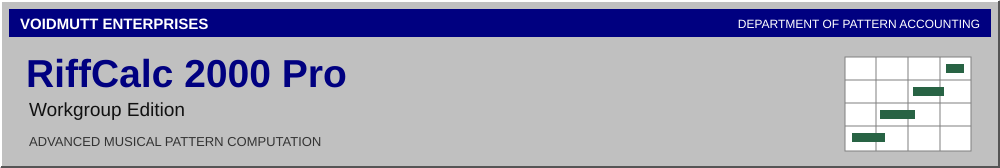
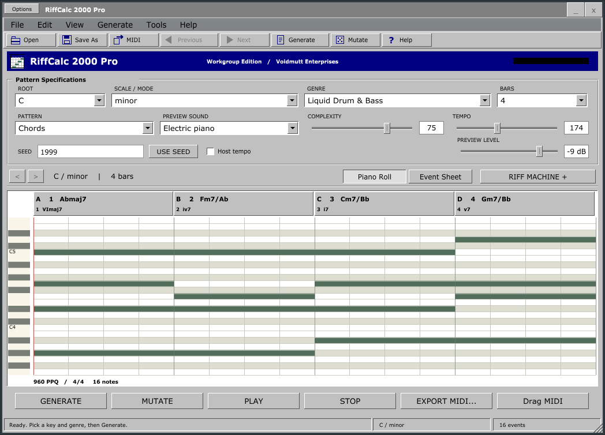
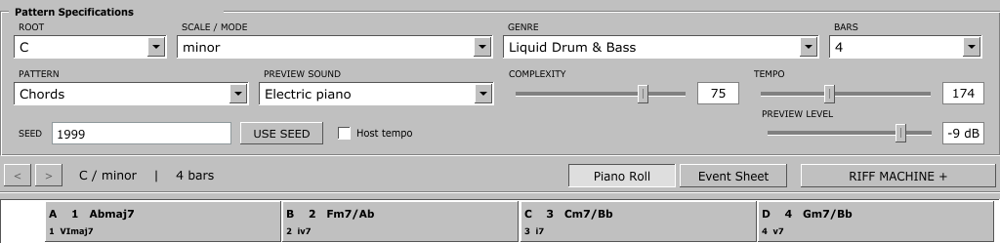
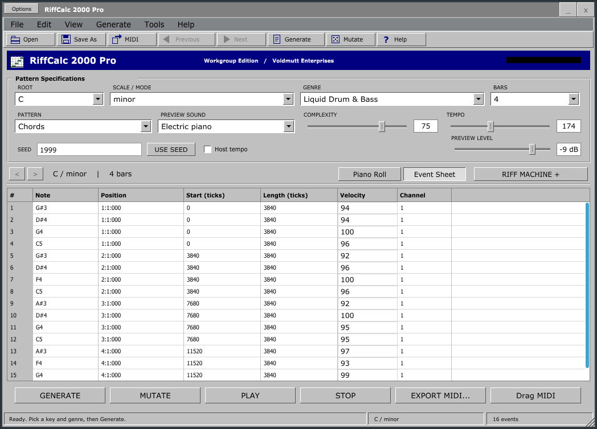
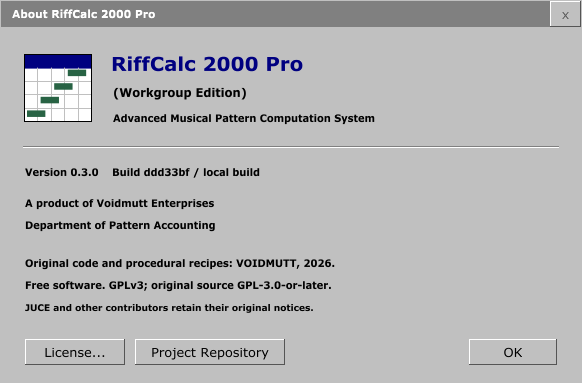

<div align="center">



**The complete desktop solution for MIDI pattern generation and management.**

[Quick Start](#your-first-pattern) ? [Features](#standard-equipment) ? [Build](#installation--system-requirements) ? [User Guide](docs/user-guide.md) ? [License](LICENSE)

**Version 0.3.0** &nbsp; | &nbsp; Windows x64 ? Standalone + VST3 &nbsp; | &nbsp; GPLv3

</div>



## Musical inspiration. Properly organized.

**RiffCalc 2000 Pro (Workgroup Edition)** is a genre-aware MIDI composition utility
from **Voidmutt Enterprises**. Select a key, scale and musical style. Generate a
progression, derive its bassline or arpeggio, audition the result, and transfer
usable MIDI into your sequencer. Explore variations without losing the original.

The workspace combines a riff machine's speed with a spreadsheet's orderly habits:
bar columns, chord analysis, an event ledger, reproducible seeds and exact note
records. The gray controls and blue title bars are deliberate. So is the music.

No subscriptions. No accounts. No inference service. Generation works entirely
offline. ?Workgroup Edition? is product branding, not a network requirement.

## Standard equipment

| Composition | Pattern management | Sequencer connection |
| :--- | :--- | :--- |
| All twelve roots; ten scales/modes | Full 64-bit reproducible seeds | Standard MIDI Files, 960 PPQ |
| Twelve declarative genre profiles | Generate, Mutate and use-seed regeneration | Type 0 individual parts |
| Weighted harmony and basic voice-leading | Harmony, voicing and rhythm locks | Type 1 four-part arrangements |
| Chords, basslines and arpeggios | Previous/next candidate history, up to 32 | Native file drag on supported Windows hosts |
| Experimental motif-based melodies | Versioned idea save/open | Conventional MIDI export fallback |
| Ten synthesized audition sounds | Pack Factory: 8, 16, 32 or 64 related ideas | Standalone or VST3 instrument |

**Included styles:** Liquid Drum & Bass, Jungle, UK Garage, House, Trance, Hard
Dance, Breakcore, Synthwave, Industrial, Ambient, Dubstep and Acid. Styles influence
harmony, voicing and rhythmic material; they are more than sound selections.

**Included scales:** major, natural minor, harmonic minor, ascending melodic minor,
Dorian, Phrygian, Mixolydian, Lydian, Locrian and minor pentatonic. Progressions span
1?16 bars in 4/4. Extended chords become available as complexity increases.



### A ledger for the details

Switch to **Event Sheet** to inspect note names, musical positions, integer start
and length ticks, velocity and MIDI channel. Double-click a velocity cell to edit
it. Enter commits; Escape cancels. Candidate history preserves the previous version.
The piano roll remains an overview rather than a full note-drawing editor.



## Your first pattern

1. **Enter the specifications.** Choose root, scale, genre, pattern and bar count.
   Start with C minor, Liquid Drum & Bass and four bars. Genre selection suggests
   a preview sound and tempo; your chosen scale remains yours.
2. **Generate.** Press **G** or choose **Generate ? New Candidate**. Complexity
   shapes chord vocabulary and density. It is not a general randomness dial.
3. **Audition.** Press **Space**. Select chords, bassline, arpeggio or melody to
   hear the related part. Escape or Stop releases preview notes. The standalone's
   **Options ? Audio/MIDI Settings** selects the output device.
4. **Explore.** **M** mutates the current idea. **Alt+Left/Right** visits candidate
   history. Open **Riff Machine Properties** to lock harmony, voicing or rhythm
   before generating again. **F5 / Use Seed** regenerates the displayed seed.
5. **File it.** Save an idea to preserve exact notes and settings. Export or drag
   the selected pattern into your DAW, then edit and orchestrate it there.

Most musical specifications apply on the next Generate. Tempo and preview level
apply immediately. Preview follows a local looping transport; optional Host Tempo
follows valid BPM, not the host's song position or play button.

### MIDI delivery

**File ? Export MIDI** writes the selected part. **Arrangement** exports a
conductor plus four named tracks: chords, bass, arp and melody, on channels 1?4.
Files include tempo, 4/4 metadata, correct note termination and an exact clip end.
RiffCalc protects existing output files; choose a new filename to retain versions.

**Drag MIDI** creates a real temporary `.mid` file for a compatible DAW to copy.
Recent files remain for seven days to accommodate delayed imports. If a host does
not accept the drop, use conventional export. MIDI is transferred as files;
RiffCalc does **not** advertise live generated MIDI output from its VST3.

**File ? Export Pack** produces a new numbered collection:

```text
RiffCalc_liquid-dnb_YYYYMMDD-HHMMSS/
  001/
    chords.mid
    bass.mid
    arp.mid
    melody.mid
    metadata.json
  002/ ...
```

Each metadata document contains the key/scale, genre/version, tempo, seed,
configuration, chord analysis and every part's exact note events. A pack is a
collection of related ideas, not a claim that every result deserves release.

## Installation & system requirements

### Run a Windows build

The portable package contains `RiffCalc.exe`, `riffcalc-cli.exe`,
`RiffCalc 2000 Pro.vst3`, licenses and the complete corresponding source.
Run **RiffCalc.exe**. No installer or system-wide changes are required.

To use the plugin, scan the package directory or manually copy the **whole**
`RiffCalc 2000 Pro.vst3` directory into your selected VST3 location. Load it as an
**instrument**. It accepts keyboard MIDI and renders stereo preview audio.

Windows x64 is the tested application target. Linux core/CLI support remains
available; Linux GUI and macOS builds are not advertised as validated releases.
The MSVC runtime is linked statically. No proprietary soundfont, ASIO SDK or
external sample library is needed.

### Build from this repository

Requirements: Visual Studio 2022 Desktop C++ tools, Windows SDK, CMake 3.25+,
and Python 3.10+. JUCE 7.0.12 and nlohmann/json 3.12.0 are vendored with their
original notices and source hashes. Configure, build and execution fetch nothing.

```powershell
# From the RiffCalc repository. The helper finds Visual Studio's CMake if needed.
powershell -NoProfile -ExecutionPolicy Bypass -File scripts/build.ps1

# Or with CMake/CTest on PATH:
cmake --preset windows
cmake --build --preset windows-release --parallel 4
ctest --preset windows-release

# Checked Debug build:
cmake --build --preset windows-debug --parallel 4
ctest --preset windows-debug
```

Standalone output: `out/windows/RiffCalc_artefacts/Release/Standalone/RiffCalc.exe`.
VST3 output: `out/windows/RiffCalc_artefacts/Release/VST3/RiffCalc 2000 Pro.vst3`.
Stop a running build-directory executable before relinking it.

For the portable core and command-line utility without JUCE application targets:

```sh
cmake -S . -B out/core -DRIFFCALC_BUILD_APP=OFF -DBUILD_TESTING=ON
cmake --build out/core --config Release -j4
ctest --test-dir out/core -C Release --output-on-failure
```

Package a tested Release with complete source and a SHA-256 file inventory:

```powershell
python scripts/package.py --build out/windows --out out/dist/RiffCalc-0.3.0-win64 --ctest ctest
```

The destination must be new. The script runs tests and creates a folder and ZIP;
it neither publishes a release nor installs a plugin. See [developer notes](docs/development.md).

### Command-line edition

```powershell
./out/windows/Release/riffcalc.exe list
./out/windows/Release/riffcalc.exe generate --key C --scale minor --genre liquid-dnb --bars 4 --complexity 70 --seed 42 --out idea.mid
```

CLI generation writes a Type 0 MIDI file and reproducibility JSON. `--help` lists
register, tempo, velocity, humanization and controlled-colour options.

## Technical particulars

The musical engine is ordinary C++20, independent of JUCE and preview synthesis.
Musical time uses integer ticks. Separate random streams keep unrelated generation
stages from perturbing each other. Fresh unlocked generation is repeatable from
engine version, profile data, seed and configuration. A mutation or locked operation
also depends on the previous candidate; idea files store the actual resulting notes.

The preview has 64 fixed voices and prepared event arrays. No generation, file
access, JSON or document locks enter the audio callback. A bounded triple buffer
transfers prepared clips. The existing algorithm and golden MIDI exports are
preserved through the rebrand. [Architecture](docs/application-architecture.md) ?
[Compatibility](docs/compatibility.md) ? [Validation record](docs/validation.md).

**Scope:** audition timbres are compact synthesized approximations, internally
mono and duplicated to stereo. Arrangement preview uses one selected sound.
Melody is experimental. There is no full piano-roll editor, real-time MIDI output,
network collaboration, mixed-profile editor or disk-backed candidate history.
Pack export runs outside audio on the message thread and can briefly occupy the
UI on slow storage. Failed new packs retain their partial directory.

FL Studio import and drag behavior still require manual verification there.
Independent VST3 loading and tests provide a narrower, documented compatibility boundary.

## About the product



**RiffCalc 2000 Pro (Workgroup Edition)**<br>
Advanced Musical Pattern Computation System<br>
A product of **Voidmutt Enterprises**<br>
Department of Pattern Accounting

Voidmutt Enterprises is the fictional publisher identity. Original application
code and procedural recipes are credited to **VOIDMUTT, 2026**, as in the original
project. RiffCalc began as PACKRAT in the VSTs collection; it now builds from an
independent repository. No historical commercial release is asserted.

## Free software, with the original paperwork

Original source is **GPL-3.0-or-later**. The combined JUCE 7 / included VST3 SDK
build uses their **GPLv3** alternatives. The complete applicable GPLv3 text is in
[LICENSE](LICENSE); authorship and third-party obligations are recorded in
[NOTICE](NOTICE) and [third_party](third_party/README.md). Upstream source is not
relicensed by this rebrand. The JSON implementation is MIT licensed.

All interface graphics and the geometric spreadsheet icon are original. No
Microsoft icons, proprietary samples, copied skins or illustrated mascots are
included. System fonts are used without redistribution.

### Contributions

Reproducible musical examples, focused bug reports, host import findings and small
patches are welcome. Include version, seed/config or saved idea, host/platform,
and expected behavior. Keep engine changes separate from interface work, retain
license notices, and run the documented checks. See [CONTRIBUTING.md](CONTRIBUTING.md).

---

<sub>Voidmutt Enterprises ? Department of Pattern Accounting ? Your Productivity Is Our Priority.</sub>
