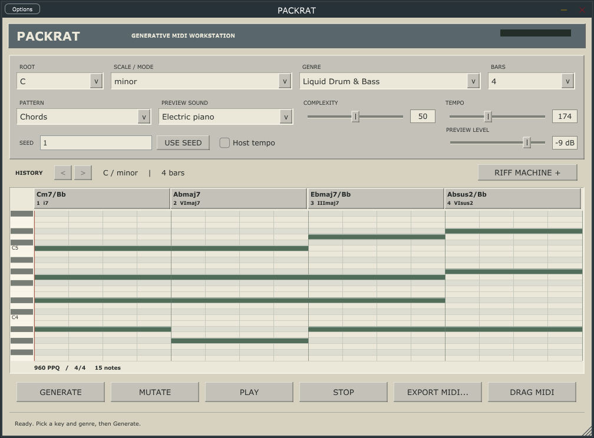

> Historical PACKRAT record, retained for provenance. [Current RiffCalc documentation](../../README.md). Build paths and milestone status below describe the earlier project.

# PACKRAT

A native, offline generative MIDI workstation. Beige panels, grey bevels and a
piano roll inspired by 1990s desktop music software. Windows x64 standalone and
VST3 instrument, sharing a JUCE editor and a JUCE-free C++20 musical engine.



## Run

Open `PACKRAT.exe` in the packaged folder. In a source build it is at
`out/windows/PACKRAT_artefacts/Release/Standalone/PACKRAT.exe`.
Use **Options > Audio/MIDI Settings** to select the standalone output device.
The program starts with a usable four-bar idea and preview stopped.

1. Choose root, scale, genre, pattern, bars and complexity.
2. **GENERATE** advances the seed and creates a candidate. **USE SEED** (or Enter
   in the seed box) uses the seed as shown, including the full uint64 range.
3. **PLAY** loops the selected part. **STOP** or Escape releases all preview notes.
4. **MUTATE** varies the current idea; history arrows retain up to 32 candidates.
5. **DRAG MIDI** into a compatible DAW, or **EXPORT MIDI** to a new `.mid` file.

**Patterns:** chords, bassline, arpeggio, melody and a four-part arrangement.
The piano roll is a read-only overview; edit exported MIDI freely in your DAW.
Chords display names and roman analysis. Selecting a genre also suggests its
preview sound and tempo. Musical settings other than tempo apply on Generate.
Changing pattern auditions another part without discarding pending generator choices.

**RIFF MACHINE** reveals arp order, chord register, velocity, humanization,
resolve/colour choices, locks, idea save/open and Pack Factory. Harmony lock
preserves chord roots/qualities. Voicing also locks harmony and keeps exact chord
pitches. Rhythm preserves all parts' note onsets and durations. Unlock before
changing key, scale or length. Other independently lockable stages are future work.

Mutation retains all but one bar's harmony and companion material, and keeps the
chord rhythmic motif. It can change voicings and articulation. A restrained seed
may produce a subtle variation. Locked transformations depend on the previous
candidate as well as the new seed; idea files store the exact resulting notes.
Fresh unlocked generation is reproducible from version, profile, config and seed.
The existing `packrat-1` algorithm and its original golden MIDI hashes are preserved.

**SAVE IDEA / OPEN IDEA** use versioned `.packrat.json` documents containing exact
note events, config, locks, part and preview settings. Save a new filename to keep
versions; existing files are protected. Rename or duplicate files conventionally.
Standalone restores its last idea from `%APPDATA%/PACKRAT/last-session.packrat.json`.
VST3 sessions preserve the same document. Playback always restores stopped.

**Pack Factory:** choose 8/16/32/64 ideas, then **EXPORT PACK** and a parent folder.
Each numbered idea contains `chords.mid`, `bass.mid`, `arp.mid`, `melody.mid` and
`metadata.json` (a complete restorable idea). Locks carry into the pack. Folder
names include genre and timestamp. Existing exports are never overwritten; a
failed export retains its partial new folder for inspection/recovery.

Shortcuts: **Space** play/stop, **G** generate, **M** mutate, **Escape** stop,
**Ctrl+E** export, **Left/Right** history. A seed text field keeps normal editing.
Tooltips explain the controls. The main view resizes from 880 x 650 upward; the expanded panel requires 800 px height.

## Use in a DAW

Point a compatible host's scanner at the packaged folder, or manually copy the
**whole `PACKRAT.vst3` directory** into your chosen VST3 directory, then rescan.
Load PACKRAT as an **instrument**. Nothing is installed by scripts or application.
The VST3 accepts MIDI keyboard notes and produces stereo audition audio. Preview,
sound, output and tempo controls support host automation. Host tempo following is
optional; invalid/missing host BPM falls back to the configured tempo.

Generated phrases leave via **SMF export/native file drag**, not a real-time VST
MIDI output. The preview transport is local: host play does not automatically
start it or align its bar position. Exported clips are aligned at tick zero.
Native drag uses Windows file-copy semantics and depends on the receiving DAW.
FL Studio import/drop behavior has not been manually verified in this session.
Export MIDI remains the fallback. Temporary drops live under
`%TEMP%/PACKRAT-midi`; only this product's matching files older than seven days
are cleaned, so delayed DAW imports can still read recent drops.

## Preview

Ten original synthesized audition timbres: piano, electric piano, warm pad,
supersaw, Reese, hoover, rave stab, pluck, acid bass and sine sub. These are compact
approximations, with no soundfont, samples, commercial instrument emulation or
VIXEN dependency. The preview is mono internally and duplicated to stereo.
Arrangement parts use the selected sound; bass sounds best previewed separately.

64 fixed voices, band-limited saw/PWM, sample-rate-aware envelopes, smoothed
output, bounded nonlinear output and preallocated event storage. Generation,
state parsing and file work are outside the callback. Ownership transfers use a
bounded triple buffer; the callback does not touch document locks or heap objects.
Preview stops with a short release; replacing an idea releases old voices and
starts the new clip at zero. The plugin reports zero latency.

## Build and test offline

Windows: Visual Studio 2022 Desktop C++ tools, Windows SDK, CMake 3.25+, Python
3.10+. Dependencies and licenses are vendored. No configure/build/runtime fetch.
From this directory:

```powershell
powershell -NoProfile -ExecutionPolicy Bypass -File scripts/build.ps1
# Or, with cmake/ctest on PATH:
cmake --preset windows
cmake --build --preset windows-release --parallel 4
ctest --preset windows-release
# Checked Debug build:
cmake --build --preset windows-debug --parallel 4
ctest --preset windows-debug
```

The helper finds Visual Studio's bundled CMake if needed. Standalone and VST3
build together. Stop any running build-directory executable before relinking it.
Static MSVC runtime linking avoids a separate Visual C++ runtime installation.
For core/CLI only, set `-DPACKRAT_BUILD_APP=OFF`. Linux preset selects core-only;
Linux GUI and macOS have not been built. GCC 11.4 core/preview validation uses
existing Ubuntu/WSL; see [validation](validation-0.2.md).

```sh
cmake --preset linux
cmake --build --preset linux-release -j4
ctest --preset linux-release
```

Package a tested Release with complete corresponding source and hashes:

```powershell
python scripts/package.py --build out/windows --out out/dist/PACKRAT-0.2.0-win64 --ctest ctest
```

This reruns tests, refuses an existing destination and produces a runnable folder
and ZIP. It copies no binaries into system plugin locations. You can build with
`cmake -S . -B <any-build-folder>`; no parent repository files are required.
[Architecture](application-architecture-0.2.md) describes the eventual repository
extraction boundary. DAWJ and the Rust plugins remain independent.

## CLI and MIDI format

```powershell
./out/windows/Release/packrat.exe list
./out/windows/Release/packrat.exe generate --key C --scale minor --genre liquid-dnb --bars 4 --complexity 70 --seed 42 --out idea.mid
```

CLI supports all 12 roots, 10 scales, 12 genre profiles, 1-16 bars, uint64 seeds,
register, tempo, velocity, humanization and optional controlled chromatic colour.
Run `--help` for options. CLI creates MIDI and a JSON sidecar exclusively.
[Milestone 1 details](docs/milestone1-cli.md) retain the original engine rationale
and historical validation; its old family-repository build paths are historical.

SMF uses **960 PPQ**, 4/4, integer tick timing, explicit note-off before note-on at
the same tick, tempo/meter/name metadata and exact end-of-track length. Individual
parts use Type 0. Arrangement uses Type 1 with a conductor and four named tracks,
channels 1-4. Batch metadata stores config, versions, profile fingerprint, seed,
chord analysis and all parts' exact notes. There are no dangling MIDI notes.

## Limits and licensing

Bass and arp are initial procedural stages; melody is an experimental repeated
motif, not a finished composition. No in-app note editing, arbitrary chord-entry,
individual-chord drag, realtime MIDI out, mixed-genre profile editor, full seven-stage
locks, disk-backed history or background batch worker is implemented. Pack export
runs outside audio but may briefly occupy the UI. No automated test proves
subjective musical quality or broad DAW compatibility.

Original code/profiles: **GPL-3.0-or-later**. JUCE **7.0.12** and its included VST3
SDK offer GPLv3 alternatives; the combined application uses the GPLv3 option.
nlohmann/json **3.12.0** is MIT. Original notices and all upstream source are kept
in `third_party/`, with archive and per-file hashes. `scripts/check_vendor.py`
verifies both inventories. No newer AGPL JUCE dependency is substituted silently.
No accounts, telemetry, runtime network clients, inference APIs or proprietary
MIDI packs are used. Windows system fonts are not redistributed.
